# Gather: a complete guide to the app

Gather is a pantry-first dinner planner. It helps someone choose a meal using the ingredients already at home, adjust the number of servings, identify missing ingredients, and work through the cooking steps.

The project combines a browser interface with a local Node.js server and three real Model Context Protocol (MCP) tools. Its conversational interface is an **Alexa+ experience simulation**. It does not connect to an Alexa device, an Amazon account, or an external language model.

This guide describes the implementation in this repository as of October 17, 2026. It separates working features from future possibilities and explains both the user experience and the code behind it.

## Contents

1. [The problem Gather addresses](#1-the-problem-gather-addresses)
2. [A complete example](#2-a-complete-example)
3. [The interface](#3-the-interface)
4. [The pantry and recipe catalog](#4-the-pantry-and-recipe-catalog)
5. [How dinner recommendations work](#5-how-dinner-recommendations-work)
6. [How the conversation works](#6-how-the-conversation-works)
7. [Recipe scaling, shopping, and cooking](#7-recipe-scaling-shopping-and-cooking)
8. [Architecture and data flow](#8-architecture-and-data-flow)
9. [The MCP tools](#9-the-mcp-tools)
10. [Saved state, privacy, and reliability](#10-saved-state-privacy-and-reliability)
11. [Design and accessibility](#11-design-and-accessibility)
12. [Running and understanding the project](#12-running-and-understanding-the-project)
13. [Testing and verification](#13-testing-and-verification)
14. [Limitations and possible next steps](#14-limitations-and-possible-next-steps)
15. [Hackathon materials](#15-hackathon-materials)

## 1. The problem Gather addresses

Many recipe tools begin with a dish name or a large catalog. Gather begins with a smaller, practical question: **“What can I make with what I already have?”**

A person may have rice, spinach, beans, and a lemon, but still need to decide which meal fits the evening. They may have only twenty minutes, need to feed four people, or want to use an ingredient before buying more food. Gather collects those constraints into a repeatable workflow:

1. Describe the pantry.
2. Set available time, servings, and preferences.
3. Compare a small number of suitable meals.
4. Check the missing ingredients.
5. Follow the recipe.

The intended benefit is less planning effort and more use of food already available. The project has not measured actual reductions in food waste, spending, or time, so those are product goals rather than demonstrated outcomes.

The deliberately small catalog makes the prototype easy to inspect and demonstrate. A recommendation can be traced to a specific recipe and an explicit scoring rule.

## 2. A complete example

The following walkthrough demonstrates the main features without microphone access or any external account.

### Start with the sample kitchen

On first use, Gather loads nine sample pantry entries. The default preferences are thirty minutes, two servings, any diet, and no exclusions. It immediately requests a dinner plan.

The sample pantry covers every listed ingredient in **Lemon chickpea bowls**, so that recipe initially shows 100% pantry coverage. That percentage means all ingredient names are present; it does not mean the pantry contains enough of each ingredient.

### Create a meaningful shopping example

Open **My pantry** and remove **Greek yogurt**. The pantry now contains eight entries. Removing an ingredient saves the change, but the existing dinner recommendations are not automatically recalculated. Request a new plan next.

### Ask for dinner

Enter this in the conversation:

```text
Plan a vegetarian dinner for two in 20 minutes
```

Gather extracts three preferences: vegetarian, two servings, and a maximum of twenty minutes. It calls the planning tool with the current pantry. Lemon chickpea bowls remain the top recommendation and now show **88% coverage**, because seven of their eight ingredient names are present.

### Change the number of people

Enter:

```text
Make it for four
```

Only the serving count changes. The twenty-minute limit and vegetarian preference remain in effect. Gather requests a fresh plan and scales the ingredient quantities for four servings.

### Prepare the shopping list

Enter:

```text
Make a shopping list
```

The missing ingredient is **1 cup Greek yogurt**. The original two-serving recipe needs half a cup, so four servings need one cup. Ingredients whose names are already in the pantry appear in the “Already in your pantry” area.

Check off the yogurt when it has been picked up, or use **Export list** to download a text file. Checking an item off does not add it to the pantry automatically.

### Cook the meal

Enter:

```text
Start cooking
```

Gather opens the top recommendation in a cooking dialog. The first step is **Prep the bright bits**, with a four-minute timer. Use **Start timer**, **Pause timer**, **Reset**, **Next step**, and **Previous step** as needed.

The second step, **Get the chickpeas golden**, has a seven-minute timer. Moving to another step resets the timer to that step's duration. The dialog is modal: while it is open, use its buttons rather than the conversation input behind it.

After closing the dialog, expand **MCP tool activity** to inspect the requests and results that produced the plan and shopping list.

## 3. The interface

### Tonight

The Tonight screen is the main decision-making view. It contains:

- Controls for maximum cooking time, number of servings, and diet.
- A **Find dinner** button that requests a new dinner plan.
- A featured recommendation with description, time, servings, diet, and pantry coverage.
- Up to two alternative recipe cards, each with its own food image, pantry coverage, missing-ingredient count, and **View recipe** / **Cook** actions.
- **Cook this** starts the featured recipe at its first step. **View recipe** opens the complete ingredient list and method before cooking.
- A pantry reminder highlighting entries marked to use soon.

Changing a dropdown alone does not submit the form. Use **Find dinner** to apply the selected values. If exclusions are active, an “Avoiding” summary provides a **Clear** button.

The browser accepts whole-number time limits from **5 to 120 minutes** and serving counts from **1 to 12**. The dropdowns offer common choices; supported values entered through the conversation can be added to those controls.

When no recipe meets the constraints, Gather displays an empty result and suggests changing the preferences. It does not invent a new recipe or silently relax a restriction.

### My pantry

Each pantry entry has a name, quantity, unit, and a personal “use within” estimate. Entries can be added, edited, or removed.

Quantity and unit help the person describe their kitchen, but the planner receives ingredient names rather than inventory amounts. A pantry entry such as “olive oil, 1 bottle” is enough to mark olive oil as present even if a recipe requires two tablespoons.

After editing the pantry, use **Find dinner** to refresh recommendations. Pantry changes do not automatically rewrite a previously generated shopping list.

### Shopping list

This screen displays a saved list for one recipe and serving count. It includes missing ingredients, required quantities, checkboxes, an export button, and the ingredients already present.

The list is a **snapshot**. Use **Refresh from pantry** after editing pantry entries. Refreshing rebuilds the list and clears its checked-item state. It uses the saved recipe ID and the current serving preference; it is not a request to find a different meal.

### About Gather

The About screen explains the product, the MCP integration, local storage, and the scope of the simulation. It is part of the app's disclosure: the project does not present its browser conversation as a live Alexa service.

### The conversation panel

The panel provides a text input, example prompts, optional browser voice features, and the tool activity log. On larger screens it sits beside the main content. On smaller screens it follows the main content vertically.

Messages are visible for the current page session. The conversation is not saved across a reload.

## 4. The pantry and recipe catalog

### Sample pantry

The starting entries are chickpeas, cooked rice, spinach, lemon, Greek yogurt, olive oil, cumin, salt, and black beans. These are demonstration data, not a record of the user's actual kitchen.

The pantry editor supports the following bounds:

| Field | Supported input |
| --- | --- |
| Number of entries | Up to 100 |
| Name | Non-empty, up to 60 characters |
| Quantity | Positive number, up to 1,000 |
| Unit | Non-empty, up to 24 characters |
| Use within | Whole number from 0 to 365 days |

Entries with a “use within” value of **three days or fewer** are sent to the planner as ingredients to prioritize. These values are manually entered numbers. Gather does not store an expiry date or reduce the number each day.

The form rejects duplicate names when they differ only by case. Alias normalization happens later in the planning logic, so two differently written aliases can still exist as separate pantry entries.

### Six original recipes

Every recipe has a stable ID, title, description, estimated duration, base serving count, tags, ingredient quantities, and ordered cooking steps. All six base recipes serve two people.

| Recipe | ID | Time | Diet tags |
| --- | --- | --- | --- |
| Lemon chickpea bowls | `lemon-chickpea-bowl` | 20 minutes | Vegetarian |
| One-pan tomato pasta | `pantry-pasta` | 25 minutes | Vegan, vegetarian |
| Smoky black bean tacos | `black-bean-tacos` | 20 minutes | Vegan, vegetarian |
| Ginger garden fried rice | `fried-rice` | 15 minutes | Vegetarian |
| Golden lentil soup | `lentil-soup` | 35 minutes | Vegan, vegetarian |
| Tomato & white bean toast | `tomato-toast` | 10 minutes | Vegan, vegetarian |

The current catalog is entirely vegetarian. Consequently, “any diet” and “vegetarian” admit the same recipes today; “vegan” narrows the selection. Dietary tags reflect the recipe definitions, not verification of the particular branded ingredients someone buys.

There is no recipe search service, recipe-generation model, or in-app recipe editor. The catalog lives in [public/domain.mjs](../public/domain.mjs).

## 5. How dinner recommendations work

The recommendation algorithm is deterministic: the same valid inputs and recipe catalog produce the same ranked results.

### Step 1: normalize ingredient names

Names are trimmed, lowercased, and normalized for repeated spaces, hyphens, and underscores. A fixed alias table handles selected equivalents, such as:

| Input | Canonical name |
| --- | --- |
| Garbanzo beans | chickpeas |
| Leftover rice | cooked rice |
| Baby spinach | spinach |
| Yogurt | greek yogurt |
| Cannellini beans | white beans |
| Tomatoes | tomato |

Matching uses the complete normalized name. It is not fuzzy matching, substring matching, or a general substitution engine. For example, an ingredient outside the alias table may not match the name a person expects it to match.

### Step 2: apply hard constraints

A recipe remains eligible only if:

1. Its duration is less than or equal to the requested limit.
2. It has the requested diet tag, unless the diet is `any`.
3. None of its ingredients matches an exclusion.

Selected exclusion groups expand into ingredient names. For this catalog, `dairy` includes Greek yogurt, `soy` includes soy sauce, and `beans` includes chickpeas, black beans, and white beans. These hand-written groups are limited and are not an allergen database.

The app never removes an ingredient from a recipe to make it pass a filter. A conflicting recipe is excluded as a whole.

### Step 3: calculate coverage and priority

For each eligible recipe:

```text
coverage = round(matched ingredient count / total ingredient count × 100)

score = coverage + (12 × matched use-soon ingredient count)
```

An ingredient earns a use-soon bonus only when it is actually present in the pantry and appears in the recipe. An arbitrary name in the `useSoon` array cannot earn a bonus if it is absent from the pantry.

Every ingredient counts equally for coverage. Salt counts as one ingredient, just as chickpeas do. Coverage is not a percentage of food weight, cost, calories, or shopping effort.

### Worked scoring example

With Greek yogurt removed, Lemon chickpea bowls match seven of eight ingredients:

```text
coverage = round(7 / 8 × 100) = 88
use-soon matches = cooked rice, spinach, lemon = 3
score = 88 + (12 × 3) = 124
```

The interface shows **88% pantry coverage**. The internal ranking score is **124**, which can exceed 100 because it includes bonuses. These are different values.

### Step 4: sort and return results

Recipes are sorted by:

1. Higher score.
2. Shorter duration when scores tie.
3. Recipe ID using the code's string comparison when both values tie.

Only the first three are returned. The UI presents the first as tonight's pick and the remaining results as alternatives. A recipe can be recommended even when some or all ingredients are missing; pantry coverage affects ranking, not eligibility.

## 6. How the conversation works

Gather's conversation uses regular expressions and a small vocabulary in `parseCommand()`. There is no generative model interpreting arbitrary requests. The app extracts recognized constraints, chooses an action, and formats a response from the tool result.

### Supported examples

| Example | Effect |
| --- | --- |
| `Plan dinner in 20 minutes` | Request a plan with a twenty-minute maximum |
| `Vegetarian dinner for two` | Set vegetarian and two servings, preserving the existing time limit |
| `Make it for four` | Change servings to four and request a new plan |
| `Vegan, under 30 minutes` | Set vegan and a thirty-minute maximum |
| `Dinner without dairy and soy` | Replace exclusions with the recognized dairy and soy groups |
| `Any diet` | Remove the diet-tag restriction; existing ingredient exclusions remain |
| `Make a shopping list` | Build a list for the selected recipe, or the top recommendation when no recipe is selected |
| `Start cooking` | Open the top recommendation in cooking mode |

Serving counts accept digits and the words one through twelve in recognized patterns such as “for four.” Cooking-time extraction expects digits followed by “minutes,” “minute,” “mins,” or “min.” “Twenty minutes” is not supported in the same way as “20 minutes.”

### Context is stored as fields

The app keeps time, servings, diet, and exclusions in a preferences object. Each recognized command updates only the fields it contains. This is why “Make it for four” can preserve the previous diet and time limit.

That context is structured application state, not language-model memory. A later exclusion command replaces the old exclusion list rather than appending to it. “Any diet” and “no dietary restrictions” change the diet field but do not clear existing ingredient exclusions; use **Clear** in the Avoiding summary for that.

### Parser boundaries

The browser conversation accepts up to 300 characters. The shared parser itself allows up to 1,000 characters, but the UI has the smaller limit. The browser validates parsed preferences before saving them, so an invalid request such as ninety-nine servings does not overwrite valid saved preferences.

Keyword matching is intentionally limited. It does not reliably understand negation, multiple unrelated instructions, arbitrary recipe names, or every everyday phrase. A sentence can contain recognizable keywords while still meaning something the parser cannot represent. Use the supplied examples or the visible controls for predictable results.

The parser includes internal `next` and `repeat` actions. In the current interface, however, the cooking dialog blocks access to the chat and microphone controls behind it. The supported practical workflow is to use the cooking dialog's navigation buttons.

### Optional browser voice

When the browser exposes a speech-recognition API, **Use voice** appears. Recognition is configured for US English and a single utterance. Recognized speech is inserted into the text box for review; it is not submitted automatically.

**Read replies aloud** uses browser speech synthesis when available. It is optional, and disabling it cancels ongoing speech. These features are browser services, not Alexa integration. The speech provider may process audio remotely, depending on the browser.

## 7. Recipe scaling, shopping, and cooking

### Scaling quantities

`getRecipe()` scales each ingredient using:

```text
scaled quantity = original quantity × requested servings / original servings
```

Results are rounded to at most three decimal places. The function returns copied ingredients, tags, and steps rather than changing the shared catalog.

Scaling does not recalculate cooking times or rewrite the instructions for a larger pan, extra batches, or equipment capacity. A twenty-minute recipe remains labeled twenty minutes after scaling. Fractional eggs, cans, or other awkward amounts can appear because the scaling is mathematical rather than a culinary adjustment system.

### Building the shopping list

`buildShoppingList()` partitions the scaled recipe ingredients into two arrays:

- `items`: ingredient names absent from the pantry.
- `available`: ingredient names present in the pantry.

For a missing ingredient, the list includes the full scaled recipe quantity. It does not subtract the amount on hand. If the pantry contains half a cup of yogurt but the meal needs one cup, yogurt still counts as present and is omitted from the missing list.

The downloaded `gather-shopping-list.txt` contains the recipe title, servings, checkbox status, missing quantities, available ingredient names, and a reminder to check quantities. The app does not place an order, compare grocery prices, or mark checked items as pantry stock.

### Cooking mode and timers

Cooking mode displays one instruction at a time, with progress indicators and a timer based on the step's authored duration. It supports starting, pausing, resuming, resetting, and restarting the timer.

The running timer stores a target wall-clock timestamp and updates the display periodically. This is more resilient to uneven display updates than subtracting one second on every interval, but it is still a browser timer. Background throttling, device sleep, or closing the page can affect when the user sees or hears completion.

Changing steps resets the timer. Closing the dialog stops it. Reloading the page loses cooking progress and timer state. The timer is a convenience for the recipe workflow, not a background alarm service or a guarantee that food is ready.

## 8. Architecture and data flow

Gather uses native browser HTML, CSS, and JavaScript modules, plus Node's built-in HTTP server. There is no React application, frontend bundler, database, or build step.

```mermaid
flowchart TD
    U[Person changes preferences or sends a command] --> B[Browser app.mjs]
    P[Browser localStorage] <--> B
    B --> C[parseCommand in domain.mjs]
    C --> B
    B --> R[POST /rpc: MCP JSON-RPC]
    R --> S[server.mjs: HTTP boundary and transport]
    S --> M[mcp.mjs: schemas and registered tools]
    M --> D[domain.mjs: catalog and pure functions]
    D --> M
    M --> S
    S --> B
    B --> V[Recipe cards, shopping list, cooking dialog, tool log]
```



### Browser responsibilities

[public/app.mjs](../public/app.mjs) manages forms, navigation, local state, conversation messages, dialogs, timers, and rendering. It imports the default pantry and command parser from the shared domain module.

Although the catalog and domain code are served as browser-readable source, the application's planning, recipe lookup, and shopping actions call the MCP server. The browser does not substitute fabricated results when the server is unavailable.

### Domain responsibilities

[public/domain.mjs](../public/domain.mjs) contains the recipe definitions and pure functions for parsing, ranking, scaling, and shopping. Pure functions make these decisions testable without a browser or running HTTP server.

The same module is imported by the backend. This avoids maintaining one set of recipe rules for tests and another for tool execution.

### Server responsibilities

[src/server.mjs](../src/server.mjs) serves the explicitly allowed frontend assets, provides `/health`, and passes MCP requests to the SDK transport at `/rpc`.

[src/mcp.mjs](../src/mcp.mjs) registers the tools, validates their inputs with Zod, calls the domain functions, and returns structured results or tool errors.

The runtime dependencies are pinned to `@modelcontextprotocol/sdk` **1.32.1** and `zod` **3.25.76**. The package lockfile records their transitive dependencies.

## 9. The MCP tools

MCP supplies the tool interface between a client and Gather's capabilities. In this project, the browser is one client, and the automated integration tests also use the official SDK client.

The endpoint is:

```text
http://127.0.0.1:4173/rpc
```

### Tool contracts

| Tool | Inputs | Main output |
| --- | --- | --- |
| `gather_plan_dinner` | `pantry`, optional `useSoon`, `maxMinutes`, `servings`, `diet`, `avoid` | Up to three recommendations and normalized constraints |
| `gather_get_recipe` | `recipeId`, optional `servings` | One recipe with scaled ingredient quantities and ordered steps |
| `gather_shopping_list` | `recipeId`, `pantry`, optional `servings` | Missing ingredients, present ingredients, and a quantity-matching note |

At the MCP boundary, ingredient arrays contain up to 100 non-empty names, each at most 80 characters. Servings default to two and must be an integer from one to twelve. Planning time defaults to thirty minutes and must be an integer from five to 120. Diet defaults to `any` and accepts only `any`, `vegetarian`, or `vegan`.

The internal domain planner accepts a wider time range of one to 180 minutes. The supported browser and MCP interfaces intentionally enforce the narrower five-to-120-minute range.

The tools are annotated as read-only, non-destructive, idempotent, and operating on a closed set of data. These annotations describe the implementation; they do not add authentication or replace input validation.

### Example tool call

After initialization, a client can send a request shaped like this:

```json
{
  "jsonrpc": "2.0",
  "id": 2,
  "method": "tools/call",
  "params": {
    "name": "gather_plan_dinner",
    "arguments": {
      "pantry": ["chickpeas", "cooked rice", "spinach", "lemon", "olive oil", "cumin", "salt", "black beans"],
      "useSoon": ["cooked rice", "spinach", "lemon"],
      "maxMinutes": 20,
      "servings": 4,
      "diet": "vegetarian",
      "avoid": []
    }
  }
}
```

Successful tool results include both `structuredContent` and a text content block containing serialized JSON. The browser prefers the structured result. Tool failures use `isError` with a text message, which the browser handles before attempting to parse a successful JSON payload.

### Transport lifecycle

The browser initializes with protocol version `2025-11-25`, sends the initialized notification, and then calls tools. Requests use JSON content, accept JSON and event-stream responses, and include the MCP protocol-version header.

The server uses the SDK's Web Standard Streamable HTTP transport in stateless mode, with JSON responses enabled and no session ID generator. It creates and closes a server/transport instance for each request. Every tool call supplies the household context it needs; the server does not remember a pantry between requests.

Only POST is supported at `/rpc`. GET returns 405 because this implementation does not provide a separate server-initiated SSE stream. That is a deliberate property of this transport configuration, not an indication that the endpoint is merely an ordinary REST route renamed to MCP.

### Visible tool activity

The browser records tool names, arguments, result or error, and elapsed client-side time. The activity panel exposes these traces so a demo can show the relationship between a command and the underlying computation.

This is an in-memory troubleshooting view. It is not a durable audit log or an independent server performance measurement.

## 10. Saved state, privacy, and reliability

### What persists

Gather stores a JSON state object in browser `localStorage` under `gather-kitchen-v1`.

| Data | Survives a page reload? |
| --- | --- |
| Pantry entries | Yes |
| Time, servings, diet, and exclusions | Yes |
| Last generated shopping-list snapshot | Yes |
| Checked shopping items | Yes |
| Conversation and tool traces | No |
| Current recommendations | Recomputed on startup |
| Selected recipe, cooking step, and timer | No |
| Read-aloud checkbox preference | No |

Browser storage belongs to a specific origin. `localhost`, `127.0.0.1`, and different ports can therefore show different saved kitchens. There is no account, cloud sync, or cross-device state. Clearing browser site data removes the saved state.

Saved pantry entries and preferences are checked on restoration. Invalid stored values are rejected rather than trusted as normal input. If a browser refuses a write, Gather displays a message explaining that the current tab must stay open to retain the change.

### What leaves the browser

Planning sends ingredient names, use-soon names, exclusions, time, servings, and diet to the local server. Recipe requests send a recipe ID and servings. Shopping requests send the recipe ID, servings, and pantry names.

The app does not send the entire conversation to an external model, and the server has no household database. Optional browser speech recognition is a separate data path: the browser's speech provider may process audio remotely.

### Reset behavior

**Reset demo** asks for confirmation, restores the sample pantry and default preferences, clears shopping state, resets the conversation and traces, closes dialogs, stops the timer, and requests a new plan. Existing personalized pantry and shopping changes are replaced; there is no undo history.

### Overlapping requests

Planning requests copy their arguments when started and carry a version counter. Only the current plan's result can replace the UI. An older response arriving later cannot overwrite a newer preference change.

Replanning clears the selected recipe and cooking state. Recipe and shopping operations also check the plan version before applying results. Reset has a separate version marker so old activity cannot repopulate the reset conversation or trace list.

These checks suppress stale results. They do not cancel the underlying network requests, which can finish in the background.

### Local HTTP boundary

The server binds to `127.0.0.1`. It checks the Host header against `localhost` and `127.0.0.1` at the actual server port, and rejects supplied Origin headers outside those local origins.

It also limits MCP bodies to 64 KiB, requires JSON content, rejects malformed JSON, and serves a fixed list of public files. Request and header timeouts are set to fifteen and ten seconds respectively. Response headers include a content security policy, `nosniff`, a no-referrer policy, and disabled caching.

These controls support the local demonstration. They do not make the server suitable for public exposure: it has no user authentication, authorization system, or production rate limiting. A public deployment would need a separate design and validation effort.

## 11. Design and accessibility

The October 17 redesign takes its visual reference from the recipe-library and recipe-detail screens on [Crouton's official site](https://crouton.app/). Gather uses a pale gray background, white content surfaces, blue action controls, compact bold system typography, rounded recipe photos, and pill-shaped preference controls. The sidebar becomes a four-item navigation row on mobile. Gather keeps its own name, content, functionality, icons, and original food images; no Crouton screenshots or branding are shipped in the app.

The featured recipe combines a food image with its time, servings, dietary label, pantry match, missing count, and cooking actions. Alternatives use a two-column photo grid. Recipe details open in a sheet with a photo header, ingredient quantities, numbered method steps, and cooking/shopping actions. Pantry and shopping views use grouped lists with clear secondary actions. The conversation panel is a light supporting surface beside the content on desktop and below it on smaller screens.

Typography follows a system font stack rather than downloading fonts. Main controls use generous touch areas; secondary metadata is intentionally smaller. Focus, selection, form caret, hover, pressed, loading, empty, and error states share the same palette. A short dialog entrance is disabled when reduced motion is requested. The six images are served from local files; they are illustrative food visuals, not measured portion or nutrition information. See [DESIGN.md](../DESIGN.md) for the visual contract and [IMAGE-CREDITS.md](IMAGE-CREDITS.md) for the image source record.

Accessibility features in the implementation include a skip link, labeled inputs and icon buttons, visible keyboard focus, active-page navigation state, live status/conversation announcements, native modal dialogs, and reduced-motion support. Cooking-step changes move keyboard focus to the new heading.

These are implemented features and focused checks, not a claim of formal accessibility certification. Screen-reader compatibility, every browser engine, and physical-device behavior have not been comprehensively tested.

## 12. Running and understanding the project

### Start locally

Install Node.js 22 or newer. Open a terminal in the `gather` directory and run:

```sh
npm ci
npm start
```

Open [the local app](http://127.0.0.1:4173). Keep the terminal open while using it; Ctrl+C stops a foreground server. No API key, Amazon account, or paid service is required for the core experience.

There is no build command because the server serves the source HTML, CSS, and browser modules directly. `npm run dev` starts Node in watch mode for development. Frontend asset changes become visible after a browser reload; there is no frontend hot-reload system.

To choose a different port in PowerShell:

```powershell
$env:PORT = '4174'
npm start
```

Then open `http://127.0.0.1:4174`. A different port also creates a different browser-storage origin.

### File map

| File | What to read it for |
| --- | --- |
| [public/index.html](../public/index.html) | Page structure, navigation, forms, dialogs, and inline icon definitions |
| [public/style.css](../public/style.css) | Visual system, layout, responsive behavior, focus, and motion |
| [public/app.mjs](../public/app.mjs) | Browser state, command handling, rendering, MCP client calls, and timers |
| [public/domain.mjs](../public/domain.mjs) | Sample pantry, recipes, normalization, ranking, scaling, shopping, and parsing |
| [public/images/](../public/images/) | Six original food images used by recipe cards and details |
| [DESIGN.md](../DESIGN.md) | Crouton-inspired visual system and responsive decisions |
| [src/mcp.mjs](../src/mcp.mjs) | Tool names, descriptions, schemas, annotations, and handlers |
| [src/server.mjs](../src/server.mjs) | HTTP routes, transport lifecycle, limits, and local serving |
| [test/app.test.mjs](../test/app.test.mjs) | Browser-state regression tests using a minimal DOM harness |
| [test/domain.test.mjs](../test/domain.test.mjs) | Pure-function tests for meal planning and parsing |
| [test/server.test.mjs](../test/server.test.mjs) | HTTP and official MCP client integration tests |
| [package.json](../package.json) | Runtime requirements, scripts, and direct dependencies |
| [package-lock.json](../package-lock.json) | Reproducible dependency versions |

### Common troubleshooting

| Symptom | Explanation or next step |
| --- | --- |
| The browser cannot connect | Start the server and use its printed local URL |
| Port already in use | Another process is listening; identify it before stopping it, or choose another port |
| “The kitchen is offline” | A tool request failed; check the server terminal and retry the plan |
| A recipe appears to ignore a pantry edit | Submit a fresh dinner plan after editing the pantry |
| The shopping list seems outdated | It is a snapshot; use Refresh from pantry |
| A recipe is unexpectedly excluded | Check the active diet and the persistent Avoiding list |
| No recipes are returned | The six-recipe catalog has no match for all current constraints |
| The pantry seems different at another URL | Browser storage is isolated by hostname and port |
| Voice is unavailable | Browser support or permission may be missing; use typed commands |

## 13. Testing and verification

Run:

```sh
npm test
npm run check
```

The recorded October 17 validation passed a clean dependency installation, **23 tests**, and JavaScript syntax checks on Windows with Node.js 24.16.

| Test group | Count | Main coverage |
| --- | --- | --- |
| Browser state | 8 | Malformed saved pantry/preferences, invalid commands, plaintext tool errors, request ordering, reset isolation, cooking focus, selected-card Cook action, shopping checkbox focus |
| Domain | 9 | Ranking, filters, aliases, scaling, shopping, use-soon bonuses, invalid input, parser behavior, catalog completeness |
| Server/protocol | 6 | Initialization, official-client tool calls, malformed/oversized/cross-origin requests, asset boundaries, hostile Host headers, all six recipe image routes |

The browser-state tests execute real application logic with a small DOM substitute. They are not a substitute for a real browser or an accessibility audit.

The recorded interactive walkthrough inspected desktop and mobile layouts and exercised pantry addition/removal, planning, two-to-four serving changes, the one-cup-yogurt shopping example, checkbox persistence, text export, cooking navigation, timer controls, and step-heading focus. These checks used the in-app browser, not a physical Alexa device or phone.

The detailed record, including what was not checked, is in [VALIDATION.md](VALIDATION.md). The redesign was checked at desktop and mobile sizes with recipe opening, direct cooking actions, pantry editing, shopping checkboxes, timer controls, and keyboard focus. These focused checks do not constitute hardware or accessibility certification.

## 14. Limitations and possible next steps

The most important current limits follow directly from the implementation:

- Six fixed recipes and a small English command vocabulary.
- Ingredient-presence matching without inventory subtraction or unit conversion.
- Manually maintained use-soon values without date tracking.
- No pantry consumption tracking when cooking finishes.
- Mathematical serving scaling without adjusted times or equipment guidance.
- No validated allergen, nutrition, or food-safety assessment.
- No Amazon account, Alexa service, AWS service, or external model integration.
- No cloud sync, grocery ordering, public deployment, or authenticated remote access.
- No persistent conversation, cooking progress, or background alarm service.

Possible future work includes quantity-aware inventory, a broader tested recipe catalog, explicit structured voice intents, a real Alexa integration, and authenticated hosting. These are proposed extensions, not existing capabilities. Each would change the validation requirements and, in some cases, the storage and privacy model.

The current project already demonstrates the complete pantry-to-plan-to-shopping-to-cooking loop with visible, repeatable tool calls. Its value as a prototype is that this loop works and can be explained from the code.

## 15. Hackathon materials

Gather was prepared for the Alexa+ simulated-experience path of the Build, Ship, Shape Amazon Developer Hackathon. The implementation demonstrates the interaction locally; it should not be described as an installed Alexa skill, certified integration, or Amazon-affiliated product.

Supporting files include:

- [README](../README.md): setup and a shorter technical overview.
- [Submission draft](SUBMISSION.md): project description and remaining entry checklist.
- [Demo script](DEMO-SCRIPT.md): a walkthrough intended for a video shorter than three minutes.
- [Product feedback](FEEDBACK.md): observations about the tools and documentation actually used.
- [Validation record](VALIDATION.md): completed checks and untested areas.
- [MIT license](../LICENSE): terms for the project's original material; dependencies retain their own licenses.

The source was published to the private [gather-kitchen repository](https://github.com/UditDewan/gather-kitchen). The recorded project handoff left demo-video publication, reviewer access, and Devpost submission outstanding. Consult the submission checklist and current event requirements before entering the project.
